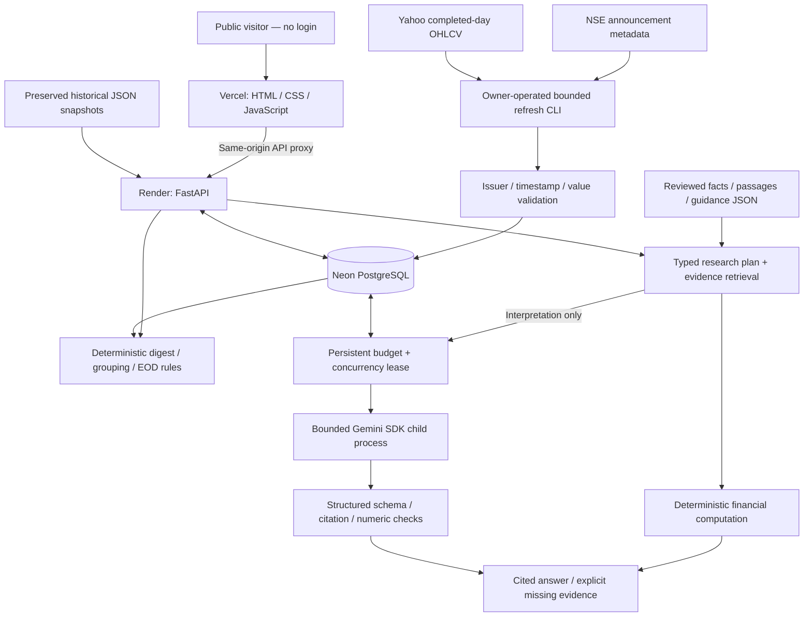

# FINN — architecture and decision record

This document separates owner-stated priorities from AI-assisted implementation choices and from future ideas. It is based on inspected runtime code, the retrieved Work message record, existing checkpoints and the owner's product/submission briefs. The separately named `FINN_Key_Architectural_Decisions.md` was not found in the two project folders; it is not represented as an inspected source. Separate ChatGPT planning conversations are not included in this package.

## Owner's decisions and their implementation

| Owner-stated decision | Implemented technical response and boundaries |
|---|---|
| Precompute expensive reusable work; organize and validate financial information upfront. | Reviewed `FinancialFact`, `SourceEvidence` and guidance records, typed dimensions, versioned corpus and reusable deterministic comparisons. Manifest-guided extraction is review-assisted, not autonomous universal PDF understanding. |
| Experience with large financial datasets and live WebSocket feeds made mappings, cleanliness, leakage, survivorship bias and missing observations important. | Explicit ticker/basis/period/currency/scale checks, provenance, publication cutoffs, missing states and a labelled mock watchlist. FINN does not implement a certified point-in-time security master or a survivorship-bias-free backtest universe. Prior experience is owner-stated; no old project code/data was accessed or copied. |
| Prefer reproducible code for financial calculations; do not ask a finite-context LLM to hold a growing financial system's entire state. | Decimal unit conversion/comparisons and supported ratios run in Python. The model receives only bounded passages for interpretation; the database/corpus holds durable state. |
| About two expected prototype users; understand free infrastructure before buying capacity. | Render Free compute + external PostgreSQL persistence + static Vercel frontend. The initial durable-SQLite approach required a persistent host/disk. PostgreSQL added TLS, schema portability, reconnection/error semantics, shared locking and restart testing complexity; it was not a cost-free architectural change in engineering terms. |
| `.gitignore` or a root `.env` is not a security boundary against an agent with filesystem access. | Owner-controlled hosting secrets, credential-free local tests, no real Gemini calls by the coding agent, no automatic `.env` loading. Ignore rules prevent accidental publication but do not isolate runtime credentials from programs with the same OS access. |
| Modular responsibilities and preventive public-demo protections. | Separate evidence/research/analytics/provider/persistence/privacy/budget modules; persistent global/client budgets and expiring leases, bounded retries, sanitized errors, private session caches and input limits. Process-local request-rate counters are not a distributed authentication system. |
| Invest personally; prioritize trustworthy dates, accessible primary evidence and useful context over volume. | Dated feed, compact deterministic category headlines, rule-based review prompts, original source details, freshness/failure labels, historical replay and concise reading explanations. No unsupported profitability claims or daily paid summarization per filing. |

The owner stated the motivations above. Specific adapters, schema/transaction implementations, UI code and regression tests were suggested or implemented with the coding agent and reviewed through iterative feedback. The message record retains failures and corrections instead of attributing every technical choice to the owner.

## System diagram

No external scheduler is currently activated. An inactive workflow template was prepared locally; manual CLI refresh is the verified implementation. Render's sleeping/restarting free process is not relied on as a scheduler. The newly downloaded November feed records were verified locally and are not automatically transferred to production by a Git push.

## Module responsibilities

| Module | Responsibility |
|---|---|
| `backend/app/main.py` | API validation, health/coverage/freshness, dated digest and company/alert routes, research responses, security headers and static serving. Public release metadata comes from a validated non-secret commit identifier. |
| `models.py` | Typed company, bar, filing, evidence, financial fact, guidance and query dimensions. |
| `acquisition.py`, `refresh.py` | Fixed public-source adapters, bounded reads, explicit watchlist imports, source timestamps, first ingestion, idempotency, atomic batches, revision history and safe failure records. |
| `analytics.py` | Rule categories, exact-attachment grouping, cutoff-aware revisions and deterministic EOD observations. Rule priority is not validated investment materiality. |
| `evidence.py`, `research.py` | Verified corpus, period/basis-aware planning, financial comparisons and citation construction. Unknown periods/tickers and future outlooks do not silently fall back to historical figures. |
| `reasoning.py`, `providers.py` | Disabled/mock/Gemini abstraction, bounded untrusted evidence prompt, structured output validation, hard SDK deadline, safe unavailable response, accounting for failed attempts and non-STOP output rejection. |
| `inference_limits.py` | Shared global/client/day/minute budgets and expiring concurrency leases. PostgreSQL advisory transaction lock or shared-file SQLite transaction serializes reservations. |
| `persistence.py`, `store.py` | Explicit SQLite/local or PostgreSQL/hosted store; bound SQL, verified remote TLS, sanitized failures, additive schema, append-preserving imports and cached responses. No uncertain write replay. |
| `client_privacy.py` | Signed HTTP-only session cookie and digest-based client/cache separation. Sessions are not user accounts. |
| `frontend/*` | Existing plain JavaScript interface; async-response guards, date/filter controls, rule thresholds, source dialogs and browser-local viewed/settings state. |

## Data and computation flow

Refresh preserves exchange publication time separately from actual ingestion time. Latest announcement candidates are sorted and bounded; repeated observations do not change first ingestion. A same-ID filing correction is stored as an immutable revision; when its true correction publication time is unknown, first observation bounds its availability in historical queries. Price corrections are held for review, not silently substituted; affected anomaly histories are suppressed. Corporate-action flags also suspend raw-price comparisons. Empty/missing/failed sources are distinct from certified absence of announcements.

EOD excludes the acquisition day because finality was not independently established. Comparisons require sufficient prior completed observations, matching provider/basis and clean data. Historical alert cutoffs exclude later price dates; April replay selects the untouched bundled dataset. This is not a complete exchange-calendar or security-master solution.

Research distinguishes **verified observed facts**, **deterministically derived values**, **missing/unverified evidence**, and potential **estimates**. No forecasting/estimation model is implemented. Units, definitions, reporting basis, fiscal years and quarter/annual periods are compared explicitly. EBITDA is not inferred from a different metric. Unknown exact publication dates are excluded when a publication cutoff is requested. Parsed exchange metadata is not promoted automatically into verified research facts.

## Selective inference and credential boundary

Direct financial questions stay deterministic. Interpretation uses a few reviewed same-issuer passages, no search/tool execution or arbitrary URL retrieval. Citation membership and numeric tokens are validated after generation. These checks do not prove qualitative entailment or correct association of every number; live answer review remains necessary. Missing evidence, provider failures and quotas preserve access to retrieved sources without pretending an interpretation succeeded.

Production key loading is lazy and server-side. The key is not placed in frontend assets. Local tests inject fake providers/credentials in a literal clean environment with external network blocked. The owner enters production secrets outside the coding-agent boundary and performs live Gemini checks independently. A successful owner-provided screenshot establishes one response, not the entire security, billing, retention or failure-handling test matrix.

## Persistence, hosting and efficiency

PostgreSQL stores imported filings/bars, refresh history/revisions, private answers, session-signing material, inference counters and leases. Bundled reviewed facts and source records remain versioned JSON. The app fails safely if the selected persistent store is unavailable; it does not create a fresh ephemeral quota database and pretend previous usage never happened.

The current Neon deployment uses direct connections, pooling OFF: adapter startup timeout options conflicted with the earlier pooler configuration. TLS certificate verification is preserved. Single-host SQLite remains a local option. Vercel proxies only fixed backend API/health paths, with research/API caching disabled. No wildcard CORS or browser-exposed Gemini key is needed.

Caching, deterministic category/financial code, bounded evidence and on-demand interpretation avoid unnecessary inference. Refresh runs separately and requires no Gemini credential. No claim is made that all account-specific free quotas or third-party data rights are guaranteed.

## Verified implementation versus future work

The CP16 code passed 200 backend, 17 disposable PostgreSQL and 12 frontend tests locally; 390px responsive checks showed no page horizontal overflow. Real local acquisition reached November 3 filings/November 2 EOD for the available sources; TATAMOTORS quotes remained missing and an original NSE PDF check timed out. Public health confirms the CP16 backend release is running with PostgreSQL. Production import and complete post-release evaluator acceptance remain separate from that successful deployment and the local tests. See [README](README.md) and [build-history index](docs/ai-build-history/README.md) for scope and provenance.

The owner's longer-term interests include helping Indian investors interpret fundamentals/annual reports, shorter-interval prices, market structure, commodities and futures. These are future directions, not implemented trading, real-time ingestion, universal research or a broad financial-literacy module. The existing reading aid is deliberately small.
