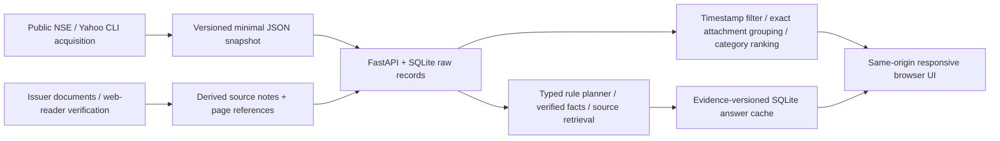

## CP09 update — 28 October 2026

[Current checkpoint](checkpoints/CP09_ELEVEN_ISSUERS_AND_ROBUSTNESS.md): 11 financial research issuers, 16 evidence records, 71 facts; eight new reviewed PDFs, 44 reproducible facts. 128 backend tests and four frontend race tests pass. [Robustness matrix](ROBUSTNESS_MATRIX.md) distinguishes implemented controls from remaining gaps. Coverage remains historical/partial; deployment and live Gemini evaluation are pending deferred configuration. Earlier entries below are historical.

# Actual local architecture

Backend: `backend/app/main.py` routes and input limits, `models.py` typed public contracts, `analytics.py` deterministic calculations, `store.py` append-preserving raw-filings store/answers/alerts, `research.py` conservative planner and source summaries. Frontend: `frontend/app.js`, `style.css`, `index.html`; native controls, safe escaped text and source links. All finance arithmetic runs on the backend.

SQLite persists under `finn.sqlite3`; set FINN_DB to a writable path if needed. One server process is the supported deployment model. No production multiworker/shared quota store. No embeddings, model SDK, task queue or paid dependency. No secrets needed.

Snapshots initialize immutable raw records using INSERT OR IGNORE. Corrections require new IDs; original entries remain. Grouping uses exact URL or an explicitly supplied attachment hash, not fuzzy semantic cross-exchange dedupe. Answer cache includes query, plan, document-note hashes and implementation version. Changing code requires incrementing its cache version.

No cloud topology exists yet. The Dockerfile is a deployment preparation artifact, not a verified deployment.
